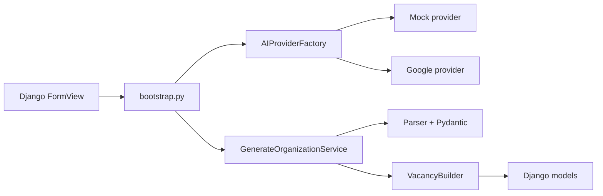

# JobLab
Integrantes:
Juan Pablo Parra El-Masri
Isabela Valencia Pino
Juan Antonio Buendía Sanchez
Joan Stiven Peralta Bedoya

JobLab transforma la descripcion de una empresa en un borrador validado de su
estructura organizacional y las vacantes necesarias. El proyecto fue construido
como solucion al taller de patrones creacionales: aplica **Service Layer**,
**Builder**, **Factory** e **inyeccion de dependencias** en un flujo Django real.

> Los organigramas, puestos y salarios son estimaciones asistidas por IA. Siempre
> deben revisarse antes de tomar decisiones o publicar una vacante.

## Funcionalidad

- Formulario accesible para describir sector, producto, objetivos, ubicacion,
  tamano y capacidad de contratacion.
- Generacion de una jerarquia empresarial con exactamente una unidad raiz.
- Vacantes con cantidad de puestos, rango salarial, moneda, periodicidad,
  descripcion, conocimientos y relacion de reporte.
- Proveedor `MOCK` determinista para desarrollo y pruebas sin costo.
- Proveedor `GOOGLE` para Gemini mediante el SDK oficial `google-genai`.
- Respuesta JSON estructurada, esquema Pydantic estricto y validacion de reglas
  antes de escribir en la base de datos.
- Transaccion atomica y trazabilidad de solicitudes completadas o fallidas.
- Historial local, panel administrativo y 22 pruebas automatizadas.

## Arquitectura



La vista maneja HTTP. El punto de composicion selecciona infraestructura. El
Service ejecuta el caso de uso. El Builder produce cada `Vacancy` valida pero sin
guardar; solo el Service decide cuando persistir dentro de la transaccion.

La explicacion completa, diagramas y correspondencia con la rubrica estan en
[Implementacion del Patron Creacional](docs/IMPLEMENTACION_PATRON_CREACIONAL.md).

## Ejecucion local

Requiere Python 3.10 o posterior. Django 5.2 soporta Python 3.10-3.14.

### PowerShell

```powershell
python -m venv .venv
.\.venv\Scripts\Activate.ps1
python -m pip install --upgrade pip
python -m pip install -r requirements.txt
python manage.py migrate
python manage.py runserver
```

### CMD

```bat
python -m venv .venv
.venv\Scripts\activate.bat
python -m pip install --upgrade pip
python -m pip install -r requirements.txt
python manage.py migrate
python manage.py runserver
```

Abre <http://127.0.0.1:8000/>. Sin variables adicionales, el proyecto utiliza
`AI_PROVIDER=MOCK` y funciona sin red ni credenciales.

## Activar Gemini

Nunca guardes la clave en Git. Puedes partir de `.env.example`, pero este proyecto
lee variables del proceso para evitar una dependencia adicional.

PowerShell:

```powershell
$env:AI_PROVIDER = "GOOGLE"
$env:GEMINI_API_KEY = "tu-clave"
$env:GEMINI_MODEL = "gemini-2.5-flash-lite"
python manage.py runserver
```

CMD:

```bat
set AI_PROVIDER=GOOGLE
set GEMINI_API_KEY=tu-clave
set GEMINI_MODEL=gemini-2.5-flash-lite
python manage.py runserver
```

Para volver al modo local cambia `AI_PROVIDER` a `MOCK`.

## Validacion

```powershell
python manage.py makemigrations --check --dry-run
python manage.py check
python manage.py test
```

Con cobertura opcional:

```powershell
python -m pip install -r requirements-dev.txt
coverage run manage.py test
coverage report
```

## Estructura principal

```text
organization/
|-- bootstrap.py                 # punto de composicion
|-- services.py                  # caso de uso y transaccion
|-- domain/
|   |-- builders.py              # VacancyBuilder fluido
|   |-- ports.py                 # contrato del proveedor
|   |-- schemas.py               # esquema y reglas de la propuesta
|   `-- validators.py            # entrada no confiable
|-- infra/ai/
|   |-- factory.py               # seleccion MOCK/GOOGLE
|   |-- mock_provider.py
|   |-- google_provider.py
|   `-- response_parser.py
|-- templates/                   # formulario, organigrama e historial
`-- tests/                       # Builder, Factory, parser, Service y vistas
```

## Seguridad y limites

- `.env`, bases locales y entornos virtuales estan excluidos de Git.
- La descripcion del usuario se valida y se presenta a Gemini como datos no
  confiables, separada de las reglas del sistema.
- El parser rechaza Markdown, campos adicionales, referencias inexistentes,
  jerarquias ciclicas, duplicados y rangos salariales incoherentes.
- Ninguna vacante se publica automaticamente: todas nacen en estado `DRAFT`.
- El modo `GOOGLE` requiere revisar costos, cuotas, privacidad y terminos del
  servicio antes de usar datos reales.
