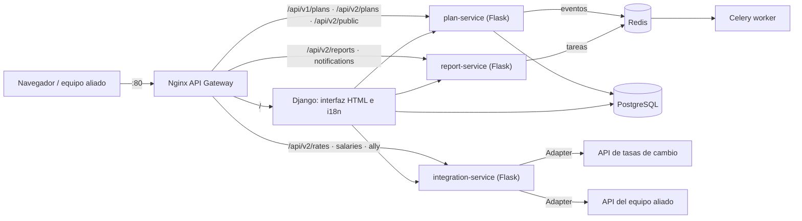

# JobLab

JobLab convierte la descripción de una empresa en un borrador validado de su
estructura organizacional y de las vacantes necesarias. En la Entrega 2 el
monolito Django se migró, con el patrón Estrangulador, a un ecosistema de
microservicios Flask detrás de un API Gateway Nginx. Incluye tareas asíncronas con
Celery y Redis, consumo de una API de terceros mediante Adapter, integración con
el equipo aliado e interfaz bilingüe (español/inglés).

> Los organigramas, puestos y salarios son estimaciones asistidas por IA. Deben
> revisarse antes de tomar decisiones o publicar una vacante.

## Integrantes

- Juan Pablo Parra El-Masri
- Isabela Valencia Pino
- Juan Antonio Buendía Sanchez
- Joan Stiven Peralta Bedoya

## Documentación

| Documento | Contenido |
| --- | --- |
| [Wiki Entrega 2](docs/ENTREGABLE_2.md) | Matriz de rúbrica, diagramas de AWS, Nginx, Flask y broker, estrangulamiento y porcentaje migrado, Adapter, flujos asíncronos y resiliencia. |
| [Auditoría UX e i18n](docs/AUDITORIA_UX_I18N.md) | Hallazgos heurísticos, correcciones y soporte bilingüe con gettext. |
| [Patrón Estrangulador (Taller 02)](docs/IMPLEMENTACION_PATRON_ESTRANGULADOR.md) | Matriz de decisión y primera extracción. |
| [Wiki Entrega 1](docs/ENTREGABLE_1.md) | Dominio, Service Layer, DRF, Builder y Factory. |
| [Patrón creacional](docs/IMPLEMENTACION_PATRON_CREACIONAL.md) | Builder, Factory e inyección de dependencias. |

## Arquitectura en una imagen



## Cómo ejecutarlo (usuario común)

La forma recomendada levanta todo el sistema con un solo comando. No necesitas
instalar Python, PostgreSQL ni Redis.

### 1. Requisitos

- [Docker Desktop](https://www.docker.com/products/docker-desktop/) (Windows o
  macOS) o Docker Engine con el plugin Compose (Linux). Ábrelo y espera a que
  indique que está en ejecución.
- [Git](https://git-scm.com/downloads), o descargar el proyecto como ZIP desde GitHub.
- Unos 4 GB de RAM libres y el puerto 80 sin usar.

### 2. Descargar el proyecto

```bash
git clone https://github.com/juanploxz/JobLab.git
cd JobLab
```

### 3. Crear el archivo de configuración

Windows (PowerShell):

```powershell
Copy-Item .env.example .env
```

macOS o Linux:

```bash
cp .env.example .env
```

Los valores por defecto funcionan sin cambios. Usan el proveedor de IA `MOCK`,
que no tiene costo ni requiere clave.

### 4. Levantar el sistema

```bash
docker compose up -d --build
```

La primera vez tarda algunos minutos porque construye las imágenes. Para ver el
estado:

```bash
docker compose ps
```

Todos los servicios deben aparecer como `running` o `healthy`.

### 5. Usar la aplicación

Abre <http://localhost/> en el navegador.

1. En **Crear estructura**, describe una empresa con al menos 80 caracteres y pulsa
   **Generar estructura**.
2. En el plan verás el organigrama, las vacantes y su salario equivalente en USD
   (tasas reales de una API externa).
3. Pulsa **Generar reporte**: el archivo se crea en segundo plano y la página se
   actualiza sola hasta que puedas descargarlo.
4. **Actividad** muestra los eventos procesados por el worker.
   **Aliados** muestra los datos del equipo aliado.
   **Estado** muestra la salud de cada microservicio.
5. El selector de la cabecera cambia el idioma entre español e inglés.

### 6. Detener el sistema

```bash
docker compose down        # conserva los datos
docker compose down -v     # borra también la base de datos
```

### Problemas frecuentes

| Síntoma | Solución |
| --- | --- |
| `port is already allocated` o el puerto 80 está ocupado | En `.env` cambia `GATEWAY_PORT=8080` y abre <http://localhost:8080/>. |
| `Bad Request (400)` al entrar por una IP o dominio | Agrega esa IP o dominio a `DJANGO_ALLOWED_HOSTS` en `.env` y ejecuta `docker compose up -d`. |
| Algún servicio no aparece `healthy` | `docker compose logs <servicio>` muestra el motivo; `docker compose restart <servicio>` lo reinicia. |
| La conversión a USD no aparece | Sin acceso a Internet se usan tasas de referencia; si tampoco hay conversión, el plan se muestra en su moneda original. |
| La página **Aliados** dice que no está configurada | Define `ALLY_SERVICE_URL` en `.env` con la URL del servicio del equipo aliado. |

## Despliegue en AWS EC2

`deploy/aws/ec2-user-data.sh` instala Docker, crea el `.env` con secretos
aleatorios y la IP pública, y levanta el sistema. `deploy/aws/deploy.sh` actualiza
un despliegue existente y `deploy/aws/smoke-test.sh http://<ip>` lo verifica. La
[Wiki de la Entrega 2](docs/ENTREGABLE_2.md#4-despliegue-en-aws-academy) describe la topología.

## Rutas del API Gateway

| Ruta | Servicio | Descripción |
| --- | --- | --- |
| `GET/POST /api/v1/plans/`, `GET /api/v1/plans/{id}/`, `POST /api/v1/plans/{id}/vacancies/` | plan-service | Contrato de la Entrega 1, ahora servido por el microservicio. |
| `/api/v2/plans/...` | plan-service | Misma API, versión 2. |
| `POST /api/v2/organizational-plan/` | plan-service | Vista previa sin persistir (Taller 02). |
| `GET /api/v2/public/summary/` | plan-service | Servicio JSON que se provee al equipo aliado. |
| `GET /api/v2/rates/?base=COP&symbols=USD` | integration-service | Tasas de cambio de un tercero vía Adapter. |
| `POST /api/v2/salaries/convert/` | integration-service | Conversión de rangos salariales en lote. |
| `GET /api/v2/ally/` | integration-service | Catálogo consumido del equipo aliado. |
| `POST /api/v2/reports/`, `GET /api/v2/reports/{task_id}/`, `.../download/` | report-service | Reportes asíncronos (`202 Accepted`). |
| `GET /api/v2/notifications/` | report-service | Eventos procesados por el worker. |
| `GET /gateway/health`, `/health/` y `/health` de cada servicio | todos | Salud. |

Ejemplo:

```bash
curl -X POST http://localhost/api/v2/plans/ \
  -H "Content-Type: application/json" \
  -H "Accept-Language: en" \
  -d '{"company_description": "Somos una empresa de software en Medellin que desarrolla una plataforma para pequenas tiendas y necesita su equipo inicial."}'
```

Los errores usan el mismo sobre en todos los servicios:

```json
{"error": {"code": "plan_not_found", "detail": "No existe un plan organizacional con id 99."}}
```

## Desarrollo sin Docker

Requiere Python 3.12 o posterior. Sin Docker no hay Redis: el servicio de reportes
ejecuta las tareas en el mismo proceso (`CELERY_TASK_ALWAYS_EAGER`).

```powershell
python -m venv .venv
.\.venv\Scripts\Activate.ps1
python -m pip install -r requirements-dev.txt -r services/plan_service/requirements.txt `
    -r services/integration_service/requirements.txt -r services/report_service/requirements.txt
python manage.py migrate
```

Abre una terminal por servicio (con el entorno virtual activado):

```powershell
# 1. plan-service
cd services/plan_service; python -m flask --app wsgi run --port 5001

# 2. integration-service
cd services/integration_service; python -m flask --app wsgi run --port 5002

# 3. report-service (tareas en proceso, sin Redis)
cd services/report_service
$env:CELERY_TASK_ALWAYS_EAGER="true"; $env:CELERY_BROKER_URL="memory://"
$env:CELERY_RESULT_BACKEND="cache+memory://"; $env:NOTIFICATION_STORE_URL="memory://"
$env:PLAN_SERVICE_URL="http://127.0.0.1:5001"; $env:INTEGRATION_SERVICE_URL="http://127.0.0.1:5002"
python -m flask --app wsgi run --port 5003

# 4. Django
$env:PLAN_SERVICE_URL="http://127.0.0.1:5001"; $env:INTEGRATION_SERVICE_URL="http://127.0.0.1:5002"
$env:REPORT_SERVICE_URL="http://127.0.0.1:5003"
python manage.py runserver
```

Abre <http://127.0.0.1:8000/>. Si Django se ejecuta sin `PLAN_SERVICE_URL`,
atiende los planes con el Service Layer heredado: es la ruta de reversión del
estrangulador.

### Gemini

```powershell
$env:AI_PROVIDER = "GOOGLE"
$env:GEMINI_API_KEY = "tu-clave"
```

En Docker, define las mismas variables en `.env`. Nunca subas la clave a Git.

## Verificación

```powershell
python manage.py makemigrations --check --dry-run
python manage.py check
python manage.py test
python scripts/i18n.py check

cd services/plan_service;        python -m unittest discover -s tests -t .
cd services/integration_service; python -m unittest discover -s tests -t .
cd services/report_service;      python -m unittest discover -s tests -t .   # requiere fakeredis
```

GitHub Actions ejecuta lo anterior y además el job `compose-smoke`, que construye
el ecosistema completo con Docker Compose y genera un plan y un reporte asíncrono
a través de Nginx.

### Traducciones

```powershell
python scripts/i18n.py extract-django   # actualiza locale/en/LC_MESSAGES/django.po
python scripts/i18n.py compile          # genera los .mo (no requiere GNU gettext)
python scripts/i18n.py check            # falla si hay cadenas sin traducir
```

## Estructura principal

```text
joblab/                    configuración Django, /health/, middleware de correlación
organization/              interfaz HTML, gateways a microservicios y Service Layer heredado
services/plan_service/     planes, unidades y vacantes (Flask + SQLAlchemy + Celery events)
services/integration_service/  tasas de cambio y equipo aliado (Adapters)
services/report_service/   reportes y notificaciones (Flask + Celery worker)
locale/                    catálogo gettext de Django
deploy/                    entrypoint, init de PostgreSQL y scripts de AWS EC2
nginx.conf                 API Gateway
docker-compose.yml         orquestación del ecosistema
docs/                      documentación y fuente de la Wiki
```

## Seguridad

- `.env`, bases locales y entornos virtuales están excluidos de Git.
- Solo el gateway publica un puerto; los demás contenedores son internos y se
  ejecutan con un usuario sin privilegios.
- La descripción de la empresa se valida antes de llegar a la IA, incluida la
  detección de instrucciones dirigidas al sistema.
- Nginx limita peticiones por IP y el tamaño del cuerpo.
- Ninguna vacante se publica automáticamente: todas nacen en estado `DRAFT`.
