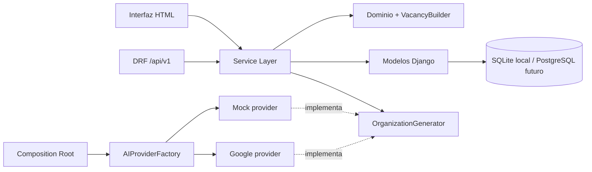

# JobLab

JobLab convierte la descripción de una empresa en un borrador validado de su
estructura organizacional y de las vacantes necesarias. La solución combina una
interfaz web en Django con una API REST versionada en Django REST Framework,
manteniendo las reglas de negocio dentro del dominio y del Service Layer.

> Los organigramas, puestos y salarios son estimaciones asistidas por IA. Deben
> revisarse antes de tomar decisiones o publicar una vacante.

## Integrantes

- Juan Pablo Parra El-Masri
- Isabela Valencia Pino
- Juan Antonio Buendía Sanchez
- Joan Stiven Peralta Bedoya

## Documentación de la Entrega 1

- [Wiki técnica versionada](docs/ENTREGABLE_1.md): matriz de rúbrica, avance del
  dominio, estructura de carpetas, diagramas, contrato REST, Service Layer y
  estrategia de API Gateway.
- [Implementación del patrón creacional](docs/IMPLEMENTACION_PATRON_CREACIONAL.md):
  detalle de Builder, Factory e inyección de dependencias.
- [Wiki de GitHub](https://github.com/juanploxz/JobLab/wiki): copia publicada para
  la entrega académica.

## Funcionalidad

- Generación de un plan organizacional desde una descripción empresarial.
- Jerarquía con exactamente una unidad raíz y relaciones padre-hijo válidas.
- Vacantes con puestos disponibles, rango salarial, moneda, periodicidad,
  descripción, conocimientos y relación de reporte.
- API REST `/api/v1/` con respuestas de entrada y salida explícitas.
- Códigos HTTP `200`, `201`, `400`, `404`, `409` y `503`, según el resultado.
- Proveedor `MOCK` determinista para desarrollo y pruebas sin costo.
- Proveedor `GOOGLE` para Gemini mediante el SDK oficial `google-genai`.
- Respuesta estructurada, esquemas Pydantic estrictos y validación por capas.
- Persistencia transaccional y trazabilidad de solicitudes completadas o fallidas.
- Historial, panel administrativo e interfaz responsive para la demostración.

## Arquitectura



La presentación traduce HTTP. Los servicios orquestan casos de uso y
transacciones. Los validadores y el Builder aplican reglas reutilizables. La
infraestructura encapsula los proveedores externos. Los serializers explícitos
y los DTOs mantienen estable el contrato REST sin exponer modelos completos.

## Arquitectura híbrida con Strangler Pattern

El proyecto ya está preparado para una estrategia de extracción gradual: el monolito Django sigue siendo el sistema principal y la funcionalidad crítica de generación del plan organizacional puede salir a un microservicio Flask sin romper el negocio.

- La documentación independiente para el Taller 02 está en
  [Implementación del patrón Estrangulador](docs/IMPLEMENTACION_PATRON_ESTRANGULADOR.md);
  no forma parte de `docs/ENTREGABLE_1.md`.
- `Django` mantiene el sistema legacy y la capa de experiencia/administración.
- `Flask` expone una ruta dedicada para la generación del plan organizacional en `/api/v2/organizational-plan/`.
- `Nginx` bifurca el tráfico según la ruta: el dominio principal sigue apuntando a Django y la ruta de migración va hacia Flask.
- `PostgreSQL` se usa en contenedores para emular un entorno de servicios separados y facilitar la demostración del patrón.

Ruta activa del microservicio:

```powershell
docker compose up --build -d

Invoke-RestMethod -Method Get -Uri "http://127.0.0.1:5000/health"

$body = @{
    company_description = "Somos una empresa de software que desarrolla productos digitales para PYMES y necesita una estructura clara para ingeniería, operaciones y ventas."
} | ConvertTo-Json -Compress

$plan = Invoke-RestMethod `
    -Method Post `
    -Uri "http://127.0.0.1/api/v2/organizational-plan/" `
    -ContentType "application/json; charset=utf-8" `
    -Body ([System.Text.Encoding]::UTF8.GetBytes($body))

$plan | ConvertTo-Json -Depth 10
```

La respuesta debe tener `source = flask`, `pattern = strangler` y una propuesta
con departamentos y vacantes. La misma ruta en el puerto `5000` permite probar
Flask directamente; usar el puerto `80` comprueba el enrutamiento de Nginx.
Las rutas no extraídas, como `/`, continúan llegando a Django. Para detener la
pila: `docker compose down`.

Pruebas automatizadas del microservicio, sin levantar contenedores:

```powershell
.\.venv\Scripts\python.exe -m unittest discover -s microservice -p "test_*.py"
```

## API REST

| Método y ruta | Resultado |
| --- | --- |
| `GET /api/v1/plans/` | Lista paginada (`page`, `page_size`, máximo 50). |
| `POST /api/v1/plans/` | Genera un plan. |
| `GET /api/v1/plans/{id}/` | Obtiene el detalle, las métricas, unidades y vacantes. |
| `POST /api/v1/plans/{id}/vacancies/` | Crea una vacante mediante `VacancyBuilder`. |
| `GET /api/v1/plans/{id}/vacancies/{vacancy_id}/` | Obtiene la vacante creada. |
| `POST /api/v2/organizational-plan/` | Genera una propuesta desde el microservicio Flask en modo estrangulador. |

Ejemplo de generación:

```powershell
$body = @{
    company_description = "Somos una empresa de software en Medellín que desarrolla soluciones para pequeñas empresas y necesita definir su equipo inicial."
} | ConvertTo-Json

Invoke-RestMethod `
    -Method Post `
    -Uri "http://127.0.0.1:8000/api/v1/plans/" `
    -ContentType "application/json" `
    -Body $body
```

Los errores usan un sobre uniforme:

```json
{
  "error": {
    "code": "plan_not_found",
    "detail": "No existe un plan organizacional con el id indicado."
  }
}
```

## Ejecución local

Requiere Python 3.10 o posterior.

### PowerShell

```powershell
python -m venv .venv
.\.venv\Scripts\Activate.ps1
python -m pip install --upgrade pip
python -m pip install -r requirements.txt
python manage.py migrate
python manage.py runserver
```

### CMD

```bat
python -m venv .venv
.venv\Scripts\activate.bat
python -m pip install --upgrade pip
python -m pip install -r requirements.txt
python manage.py migrate
python manage.py runserver
```

Abre <http://127.0.0.1:8000/>. Sin variables adicionales, el proyecto usa
`AI_PROVIDER=MOCK` y funciona sin red ni credenciales.

## Activar Gemini

Nunca guardes la clave en Git. El proyecto lee la configuración del proceso; el
archivo `.env.example` sirve como referencia.

PowerShell:

```powershell
$env:AI_PROVIDER = "GOOGLE"
$env:GEMINI_API_KEY = "tu-clave"
$env:GEMINI_MODEL = "gemini-2.5-flash-lite"
python manage.py runserver
```

CMD:

```bat
set AI_PROVIDER=GOOGLE
set GEMINI_API_KEY=tu-clave
set GEMINI_MODEL=gemini-2.5-flash-lite
python manage.py runserver
```

## Verificación

```powershell
python manage.py makemigrations --check --dry-run
python manage.py check
python manage.py test
```

Para medir cobertura:

```powershell
python -m pip install -r requirements-dev.txt
coverage run manage.py test
coverage report
```

> Verificación local del entregable: **55 pruebas aprobadas**, migraciones sin
> cambios pendientes y `manage.py check` sin errores.

GitHub Actions ejecuta las comprobaciones en un entorno limpio. Para que la
evidencia sea válida, el workflow verde debe corresponder al SHA entregado en
`main` o `develop`.

## Estructura principal

```text
joblab/                           configuración y rutas globales
organization/
|-- api/                         APIView, serializers y rutas REST
|-- domain/                      reglas, schemas, puerto y Builder
|-- infra/ai/                    Factory, providers y parser
|-- migrations/                 evolución del esquema
|-- templates/ y static/        interfaz web
|-- tests/                       pruebas unitarias y de integración
|-- dtos.py                      comandos y resultados neutrales a HTTP
|-- models.py                    entidades y restricciones persistentes
`-- services.py                  casos de uso y transacciones
docs/                             documentación y fuente de la Wiki
.github/workflows/               validación continua
```

## Seguridad y límites

- `.env`, bases locales y entornos virtuales están excluidos de Git.
- La descripción se trata como entrada no confiable y se valida antes de Gemini.
- El parser rechaza Markdown, campos adicionales, referencias inexistentes,
  jerarquías cíclicas, duplicados y salarios incoherentes.
- Ninguna vacante se publica automáticamente: todas nacen en estado `DRAFT`.
- El modo `GOOGLE` exige revisar costos, cuotas, privacidad y términos del
  proveedor antes de procesar información real.
