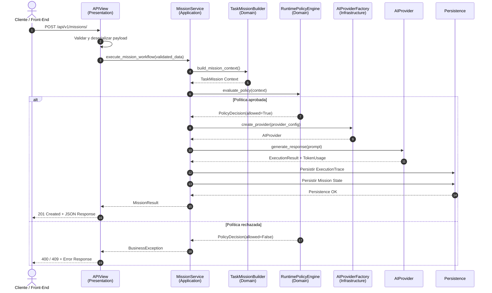

# Documentación Técnica y Arquitectura — Squadron_AI (JobLab)

## 1. Justificación de la Estructura de Carpetas

La arquitectura de **Squadron_AI (JobLab)** se diseñó siguiendo los principios de **Domain-Driven Design (DDD)** y **Clean Architecture**, con el objetivo de mantener una separación clara de responsabilidades, reducir el acoplamiento entre componentes y facilitar la evolución, pruebas y escalabilidad del sistema.

La estructura propuesta organiza el código de acuerdo con las responsabilidades de cada capa:

```text
organization/
├── domain/
│   ├── builders.py
│   ├── schemas.py
│   └── ...
├── infra/
│   ├── factory.py
│   └── ...
├── services.py
├── views.py
└── ...
```

### `organization/domain/` — Capa de Dominio

Esta capa concentra las **reglas de negocio y conceptos fundamentales del dominio**. Su principal característica es que debe mantenerse independiente de frameworks, mecanismos de persistencia y proveedores externos.

Entre sus responsabilidades se encuentran:

* Definición de entidades y objetos asociados al dominio.
* Validaciones y reglas de negocio.
* Esquemas y estructuras de datos utilizados por los casos de uso.
* Construcción de objetos complejos mediante patrones creacionales, como `TaskMissionBuilder`.
* Definición de contratos o interfaces que permitan desacoplar el dominio de implementaciones concretas.

El objetivo es que las reglas centrales del negocio puedan evolucionar sin depender directamente de Django, Django REST Framework, una base de datos específica o un proveedor determinado de inteligencia artificial.

### `organization/services.py` — Capa de Aplicación

Esta capa implementa la **orquestación de los casos de uso de la aplicación**.

Los servicios reciben datos previamente validados, coordinan las diferentes operaciones necesarias para ejecutar un caso de uso y controlan el flujo entre el dominio, las políticas de ejecución, la infraestructura y la persistencia.

Por ejemplo, `MissionService` puede encargarse de:

1. Construir el contexto de ejecución de una misión.
2. Aplicar las políticas y restricciones correspondientes.
3. Solicitar la ejecución al proveedor de IA seleccionado.
4. Registrar el resultado y las métricas de ejecución.
5. Persistir el estado de la misión y su trazabilidad.
6. Propagar excepciones de negocio de forma controlada.

De esta manera, `views.py` no necesita conocer los detalles internos del proceso de ejecución.

### `organization/infra/` — Capa de Infraestructura

Esta capa contiene las implementaciones concretas necesarias para interactuar con **servicios externos y mecanismos tecnológicos**.

Un componente relevante es `factory.py`, que implementa el patrón **Factory**, permitiendo seleccionar y construir dinámicamente el proveedor de inteligencia artificial utilizado durante una ejecución.

Por ejemplo, conceptualmente:

```text
MissionService
      │
      ▼
AIProviderFactory
      │
      ├── Provider A
      ├── Provider B
      └── Provider C
```

Este enfoque permite incorporar nuevos proveedores sin modificar directamente la lógica central del caso de uso.

La infraestructura también puede encapsular posteriormente integraciones como:

* Proveedores de modelos de lenguaje.
* Servicios de almacenamiento.
* Sistemas de mensajería.
* Servicios de observabilidad.
* Clientes HTTP externos.
* Mecanismos de caché.

### `organization/views.py` — Capa de Presentación

La capa de presentación está implementada mediante **Django REST Framework (DRF)** y tiene como responsabilidad principal gestionar la comunicación HTTP.

Las vistas se mantienen deliberadamente delgadas y se encargan principalmente de:

* Recibir las peticiones HTTP.
* Validar y deserializar los datos de entrada.
* Invocar los casos de uso correspondientes.
* Transformar los resultados en respuestas HTTP.
* Gestionar la representación de errores y códigos de estado.

La lógica de negocio no debe residir en esta capa. Esto evita convertir las vistas en componentes monolíticos difíciles de probar y mantener.

### Principio de Dependencia

La arquitectura busca que las dependencias apunten hacia las reglas de negocio y no hacia los detalles de infraestructura:

```text
Presentation
     │
     ▼
Application / Services
     │
     ▼
Domain
     ▲
     │
Infrastructure
```

En consecuencia, un cambio de framework, proveedor de IA o mecanismo de persistencia debería tener un impacto limitado sobre el núcleo funcional del sistema.

---

# 2. Diagrama de Secuencia de la Funcionalidad de Mayor Complejidad

Una de las funcionalidades más relevantes del sistema corresponde al procesamiento de una **Misión de Agente (`TaskMission`)**, debido a que involucra validación, construcción del contexto, aplicación de políticas, ejecución mediante un proveedor de IA y persistencia de la trazabilidad.

El siguiente diagrama representa el flujo principal:



### Descripción del flujo

**1. Recepción de la solicitud**

El cliente realiza una petición `POST` al endpoint versionado:

```text
POST /api/v1/missions/
```

La capa de presentación recibe el payload y realiza la validación sintáctica y estructural correspondiente.

**2. Ejecución del caso de uso**

Una vez validados los datos, la vista delega la operación en `MissionService`. A partir de este punto, el flujo deja de depender directamente de HTTP.

**3. Construcción del contexto de misión**

`TaskMissionBuilder` se utiliza para construir el contexto necesario para la ejecución. El patrón Builder resulta especialmente útil cuando la misión contiene múltiples parámetros opcionales o reglas de construcción que deben mantenerse centralizadas.

**4. Evaluación de políticas**

Antes de consumir recursos de inferencia, `RuntimePolicyEngine` evalúa las restricciones aplicables.

Estas políticas pueden contemplar, entre otros aspectos:

* Límites presupuestarios.
* Consumo máximo de tokens.
* Permisos del cliente.
* Restricciones de ejecución.
* Guardrails definidos por el negocio.
* Condiciones específicas del agente.

Esta etapa funciona como un **control previo al consumo de recursos**, evitando ejecutar una operación costosa cuando no cumple las condiciones establecidas.

**5. Selección del proveedor de IA**

Si la política es aprobada, `MissionService` solicita a `AIProviderFactory` la implementación correspondiente del proveedor de IA.

El uso del patrón Factory permite desacoplar el caso de uso de una implementación concreta y facilita la incorporación de nuevos proveedores.

**6. Ejecución y trazabilidad**

El proveedor procesa el prompt y devuelve el resultado junto con información asociada al consumo, como el uso de tokens.

Posteriormente, el servicio persiste tanto el resultado de la misión como su `ExecutionTrace`, permitiendo mantener trazabilidad sobre las ejecuciones realizadas.

**7. Manejo de errores de negocio**

Si la política rechaza la operación —por ejemplo, debido a un presupuesto excedido— el servicio genera una excepción de negocio controlada.

La capa de presentación transforma dicha excepción en una respuesta HTTP apropiada, evitando que detalles internos del dominio sean expuestos directamente al cliente.

---

# 3. Visión de Escalabilidad e Integración con un API Gateway

La arquitectura de **Squadron_AI** está preparada para incorporar un **API Gateway** como punto de entrada unificado en escenarios de crecimiento y escalabilidad horizontal.

Esta evolución permitiría separar progresivamente las responsabilidades de exposición pública, seguridad y gestión del tráfico de las responsabilidades propias del backend de negocio.

Una arquitectura futura podría representarse de la siguiente manera:

```text
                         ┌─────────────────┐
                         │    Front-End    │
                         └────────┬────────┘
                                  │
                                  ▼
                         ┌─────────────────┐
                         │   API Gateway   │
                         │                 │
                         │ Auth / Routing  │
                         │ Rate Limiting   │
                         │ Observability   │
                         └────────┬────────┘
                                  │
                    ┌─────────────┼─────────────┐
                    ▼             ▼             ▼
             ┌────────────┐ ┌────────────┐ ┌────────────┐
             │ Agent API  │ │ Mission API│ │ Future API │
             │ Instance 1 │ │ Instance 2 │ │ Service N  │
             └────────────┘ └────────────┘ └────────────┘
```

### 3.1 Desacoplamiento de rutas y versionamiento

La utilización de endpoints versionados, como:

```text
/api/v1/
```

permite establecer un contrato estable entre los consumidores y la plataforma.

El API Gateway puede utilizar este esquema para realizar tareas de enrutamiento hacia diferentes instancias o servicios sin exigir modificaciones en la lógica interna del dominio.

Esto facilita una futura transición desde un **monolito modular** hacia una arquitectura distribuida, en caso de que las necesidades de escala lo justifiquen.

### 3.2 Autenticación y centralización de seguridad

El Gateway puede asumir determinadas responsabilidades de seguridad que no necesitan ejecutarse repetidamente en cada servicio.

Entre ellas:

* Validación de JWT.
* Gestión de API Keys.
* Identificación del cliente.
* Políticas de acceso.
* Control de origen.
* Terminación TLS.
* Inyección de contexto de identidad.

El backend puede recibir únicamente el contexto de identidad que necesita para ejecutar las reglas de negocio.

Esto constituye un mecanismo de **security offloading**, aunque las validaciones críticas de autorización deben continuar siendo responsabilidad del backend y del dominio cuando corresponda.

### 3.3 Rate Limiting y Throttling

Las operaciones basadas en modelos de IA pueden representar un costo significativo debido al consumo de recursos de inferencia y tokens.

Por esta razón, el API Gateway puede actuar como una primera barrera para controlar el tráfico mediante políticas como:

```text
Cliente
   │
   ▼
API Gateway
   │
   ├── Rate Limit
   ├── Quota
   ├── Authentication
   └── Request Filtering
          │
          ▼
     Backend / Agent
```

Esto permite limitar la cantidad de solicitudes por cliente, organización o API Key antes de que estas alcancen las capas de aplicación y dominio.

Sin embargo, el control de tráfico en el Gateway debe complementarse con las políticas internas de `RuntimePolicyEngine`, ya que el Gateway controla principalmente **tráfico**, mientras que el motor de políticas controla **reglas de negocio y consumo permitido**.

### 3.4 Escalabilidad horizontal

Al mantener las vistas desacopladas de la lógica de negocio y centralizar los casos de uso en la capa de servicios, múltiples instancias del backend pueden ejecutar el mismo código de aplicación.

Por ejemplo:

```text
                  API Gateway
                       │
          ┌────────────┼────────────┐
          ▼            ▼            ▼
      Backend 1    Backend 2    Backend 3
          │            │            │
          └────────────┼────────────┘
                       ▼
                Shared Services
```

Esto permite incrementar la capacidad de procesamiento agregando nuevas instancias en lugar de aumentar exclusivamente los recursos de una única máquina.

---

# 4. Beneficios Arquitectónicos

La arquitectura propuesta proporciona los siguientes beneficios:

| Principio                    | Beneficio                                                           |
| ---------------------------- | ------------------------------------------------------------------- |
| **DDD**                      | El código representa explícitamente conceptos y reglas del dominio. |
| **Clean Architecture**       | Reduce el acoplamiento entre negocio y tecnología.                  |
| **Service Layer**            | Centraliza la ejecución de casos de uso.                            |
| **Builder Pattern**          | Simplifica la construcción de contextos complejos.                  |
| **Factory Pattern**          | Permite intercambiar e incorporar proveedores de IA.                |
| **Policy Engine**            | Centraliza guardrails y restricciones de ejecución.                 |
| **API Versioning**           | Facilita la evolución del contrato de la API.                       |
| **API Gateway**              | Permite centralizar routing, seguridad y control de tráfico.        |
| **Persistencia de trazas**   | Proporciona auditabilidad y observabilidad de las ejecuciones.      |
| **Escalabilidad horizontal** | Permite aumentar capacidad mediante múltiples instancias.           |

## 5. Conclusión

La arquitectura de **Squadron_AI (JobLab)** busca establecer una base técnica preparada no solo para resolver los requerimientos funcionales actuales, sino también para soportar la evolución futura de la plataforma.

La separación entre **dominio, aplicación, infraestructura y presentación** permite modificar componentes tecnológicos sin comprometer las reglas centrales del negocio. A su vez, el uso de patrones como **Builder** y **Factory**, junto con un motor explícito de políticas de ejecución, proporciona mecanismos claros para gestionar la complejidad propia de una plataforma basada en agentes de inteligencia artificial.

Finalmente, la adopción de **API versioning**, junto con la posibilidad de incorporar un **API Gateway**, permite evolucionar progresivamente desde un monolito modular hacia una arquitectura con múltiples instancias o servicios independientes cuando las necesidades de carga, disponibilidad o organización del sistema lo requieran.

De esta manera, la arquitectura no solo responde a las necesidades actuales de JobLab, sino que establece una base sólida para su **mantenibilidad, extensibilidad, observabilidad y escalabilidad**.
