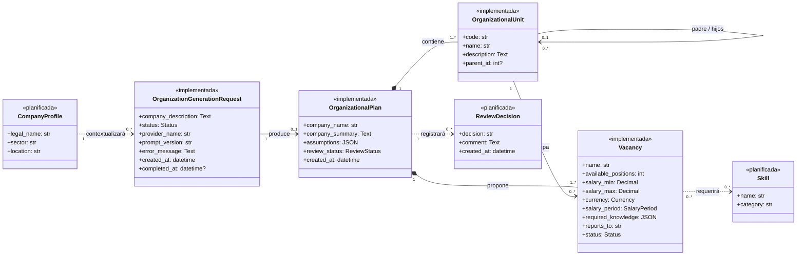
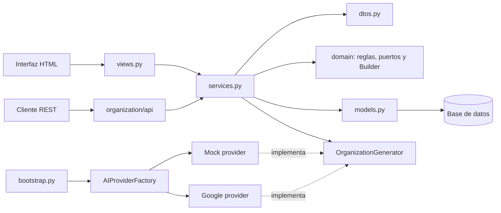
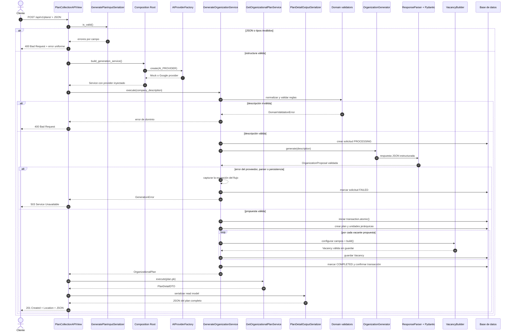
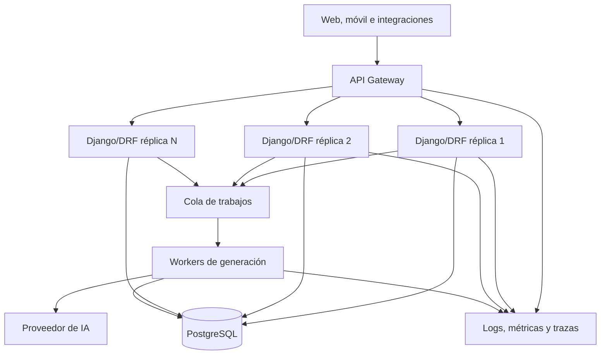

# Wiki técnica — Entrega 1

## JobLab: núcleo de negocio y exposición de API profesional

Este documento es la fuente versionada de la Wiki técnica de la Entrega 1. Su
contenido describe el sistema que existe en este repositorio: JobLab recibe la
descripción de una empresa, genera una propuesta de estructura organizacional y
permite consultar el plan y administrar sus vacantes mediante una API REST.

La página debe publicarse también en la [Wiki del repositorio](https://github.com/juanploxz/JobLab/wiki)
antes de entregar. Mantener esta copia en `docs/` permite revisar los cambios de
arquitectura junto con el código.

## 1. Matriz de cumplimiento de la rúbrica

| Criterio | Peso | Evidencia verificable |
| --- | ---: | --- |
| Dominio y avance | 1.0 | Cuatro de las siete entidades del baseline están implementadas: `OrganizationGenerationRequest`, `OrganizationalPlan`, `OrganizationalUnit` y `Vacancy` en `organization/models.py`. El avance es `4 / 7 = 57,1 %`. |
| SOLID y Service Layer | 1.5 | Los flujos se orquestan en `organization/services.py`; las vistas y los serializers se limitan a traducir HTTP. Los servicios reciben colaboradores sustituibles y, según el caso, devuelven entidades, read models o DTOs. |
| DRF y API Gateway | 1.0 | API versionada en `/api/v1/`, serializers separados de entrada y salida, clases `APIView`, respuestas uniformes y códigos `200`, `201`, `400`, `404`, `409` y `503`. La estrategia de Gateway está en la sección 9. |
| Patrones creacionales | 1.0 | `VacancyBuilder` construye y valida la entidad persistente más compleja. `AIProviderFactory` selecciona la dependencia externa `MOCK` o `GOOGLE`. Ambos patrones están fuera de la presentación. |
| Documentación técnica | 0.5 | Esta página justifica la estructura, muestra el modelo de dominio y el diagrama de secuencia, explica decisiones y separa el estado actual de la evolución hacia un API Gateway. |

La trazabilidad detallada de Builder, Factory e inyección de dependencias se
amplía en [Implementación del patrón creacional](https://github.com/juanploxz/JobLab/blob/main/docs/IMPLEMENTACION_PATRON_CREACIONAL.md).

## 2. Alcance funcional implementado

El flujo principal de JobLab realiza estas tareas:

1. recibe una descripción empresarial no confiable;
2. valida longitud, contenido y límites antes de invocar IA;
3. selecciona un proveedor mediante `AIProviderFactory`;
4. obtiene y valida una propuesta estructurada;
5. crea un plan, una jerarquía de unidades y sus vacantes en una transacción;
6. registra si la solicitud terminó o falló;
7. expone consultas y creación de vacantes mediante DRF;
8. conserva la interfaz HTML para demostrar el backend desde el lado del usuario.

Las estimaciones generadas son borradores. Ningún organigrama, salario o vacante
se publica automáticamente.

## 3. Baseline del dominio y avance del 57,1 %

Esta entrega formaliza un baseline de siete entidades para que el porcentaje de
avance sea explícito, reproducible y no dependa de contar clases de
infraestructura. Se implementaron cuatro entidades persistentes y quedaron tres
para iteraciones posteriores.

| Entidad del baseline | Estado | Responsabilidad |
| --- | --- | --- |
| `OrganizationGenerationRequest` | Implementada | Trazabilidad de la solicitud, proveedor, versión del prompt, estado, error y tiempos. |
| `OrganizationalPlan` | Implementada | Resultado agregado: empresa, resumen, supuestos y estado de revisión. |
| `OrganizationalUnit` | Implementada | Unidad jerárquica del organigrama y relación padre-hijo. |
| `Vacancy` | Implementada | Puestos, rango salarial, moneda, periodicidad, conocimientos, reporte y estado. |
| `CompanyProfile` | Planificada | Perfil empresarial reutilizable para separar los datos estables de cada solicitud de generación. |
| `Skill` | Planificada | Catálogo normalizado de conocimientos para búsqueda y reutilización entre vacantes. |
| `ReviewDecision` | Planificada | Historial auditable de revisiones y aprobaciones del plan. |

El cálculo incluye únicamente entidades del modelo de negocio:

```text
entidades implementadas / entidades propuestas = 4 / 7 = 57,1 %
```

Los servicios, serializers, DTOs, builders, providers y vistas no se cuentan
como entidades de dominio. Las tres entidades planificadas aparecen para
formalizar la dirección del producto; no se presentan como código existente.

### Diagrama de clases del dominio



### Tipos y reglas en el nivel de entidad

Los modelos usan tipos acordes con la información: `DecimalField` para dinero,
`PositiveIntegerField` para cantidades, enumeraciones para estados, moneda y
periodicidad, `JSONField` para listas validadas y relaciones `ForeignKey` o
`OneToOneField` para integridad referencial.

Las reglas que deben sobrevivir a cualquier interfaz se aplican mediante
validadores y restricciones de base de datos. Entre ellas están:

- una sola unidad raíz por plan;
- códigos de unidad únicos dentro del plan;
- una unidad no puede ser su propio padre;
- entre 1 y 500 puestos por vacante;
- salario mínimo no negativo y salario máximo mayor o igual al mínimo;
- una vacante no puede repetirse —sin distinguir mayúsculas— en el mismo
  departamento y plan;
- descripciones, nombres, supuestos y conocimientos con límites explícitos.

## 4. Justificación de la estructura de carpetas

```text
JobLab/
|-- joblab/                       # configuración y enrutamiento global de Django
|-- organization/                # módulo funcional de planeación organizacional
|   |-- api/                     # adaptador HTTP DRF: serializers, views y urls
|   |-- domain/                  # reglas, contratos, esquemas y Builder
|   |-- infra/ai/                # adaptadores de IA, parser y Factory
|   |-- migrations/              # evolución reproducible del esquema
|   |-- templates/               # presentación HTML del módulo
|   |-- static/                  # CSS y JavaScript del módulo
|   |-- tests/                   # pruebas unitarias y de integración
|   |-- dtos.py                  # comandos y resultados independientes de HTTP
|   |-- models.py                # entidades persistentes y restricciones
|   |-- services.py              # casos de uso y transacciones
|   `-- views.py                 # adaptador de presentación HTML
|-- templates/                    # plantilla base compartida
|-- docs/                         # documentación versionada y fuente de la Wiki
|-- .github/workflows/            # controles automáticos de calidad
|-- manage.py
`-- requirements.txt
```

### `joblab/`: configuración del proyecto

Contiene settings, enrutamiento raíz, WSGI/ASGI y preocupaciones HTTP
transversales. No contiene reglas del organigrama ni de vacantes. Esta separación
evita mezclar configuración de despliegue con el módulo funcional.

### `organization/`: módulo funcional

Agrupa todo lo que cambia por la misma razón de negocio: generar y administrar
planes organizacionales. Django permite evolucionarlo como aplicación modular y
evita repartir el mismo flujo entre carpetas globales sin cohesión.

### `organization/domain/`: reglas y contratos

Reúne validadores, esquemas estrictos de propuestas, excepciones, el protocolo
`OrganizationGenerator` y `VacancyBuilder`. Esta capa no conoce HTTP, códigos de
estado, requests, responses ni serializers. El Builder materializa una entidad
Django sin guardarla; el Service conserva el control de la transacción.

### `organization/services.py`: capa de aplicación

Cada flujo principal tiene una clase explícita:

- `GenerateOrganizationService` genera y persiste el plan completo;
- `ListOrganizationalPlansService` produce el listado de planes;
- `GetOrganizationalPlanService` obtiene el detalle o informa ausencia;
- `CreateVacancyService` crea una vacante o informa un conflicto;
- `GetVacancyService` obtiene una vacante dentro de su plan;
- `CalculatePlanMetricsService` calcula métricas fuera de las vistas;
- `GetPlanDashboardService` prepara el read model de la página HTML de detalle.

Los servicios reciben dependencias sustituibles y, cuando aplica, trabajan con
comandos o DTOs.
Aquí viven la orquestación, las transacciones y las decisiones de negocio; no en
las vistas ni en los serializers.

### `organization/api/`: adaptador DRF

Separa serializers de entrada, serializers de salida, vistas y URLs. Las
`APIView` validan la forma del JSON, delegan en servicios de aplicación y
traducen resultados o excepciones a HTTP. Los serializers no consultan la base
de datos ni calculan reglas de negocio.

### `organization/infra/ai/`: infraestructura externa

Encapsula el SDK de Gemini, el proveedor determinista para pruebas, el parser y
la Factory. Cambiar de proveedor no obliga a modificar el algoritmo del Service,
porque ambos implementan el protocolo `OrganizationGenerator`.

### Presentación, persistencia, pruebas y documentación

- `templates/` y `static/` conservan la demostración navegable sin contaminar el
  dominio con HTML o JavaScript.
- `migrations/` hace auditable y repetible la evolución de la base de datos.
- `tests/` refleja Builder, Factory, validación, servicios, HTML y contrato REST.
- `docs/` conserva decisiones técnicas en el mismo control de versiones.
- `.github/workflows/` ejecuta controles sobre un entorno limpio antes de integrar.

### Dirección de las dependencias



## 5. Service Layer y cumplimiento de SOLID

La presentación conoce los casos de uso, pero los casos de uso no conocen DRF.
El Service Layer recibe datos ya deserializados, aplica las reglas mediante el
dominio, coordina persistencia y devuelve entidades, read models, DTOs o errores
de aplicación según el caso de uso.

| Principio | Aplicación en JobLab |
| --- | --- |
| SRP | APIView traduce HTTP; serializer valida estructura; Service orquesta; Builder construye; provider integra; modelo persiste. |
| OCP | Un nuevo proveedor puede añadirse implementando `OrganizationGenerator` y registrándolo en la Factory, sin cambiar el flujo de generación. |
| LSP | `MockOrganizationProvider` y `GoogleOrganizationProvider` son sustituibles detrás del mismo contrato. |
| ISP | El puerto de generación exige solo `name` y `generate()`. Los servicios REST reciben DTOs pequeños orientados a cada caso de uso. |
| DIP | `GenerateOrganizationService` recibe el proveedor; `CreateVacancyService` recibe modelos y una factoría de Builder sustituibles para pruebas. |

Las consultas de presentación y el cálculo de posiciones totales también se
encapsulan en servicios, evitando “Fat Views”. Las restricciones duraderas están
en validadores, Builder y base de datos, evitando “Fat Models” con orquestación.

## 6. Patrones creacionales obligatorios

### Builder: construcción de la entidad más compleja

`Vacancy` es la entidad persistente con más combinaciones y reglas: pertenece a
un plan y departamento, contiene cantidad de puestos, rango salarial, moneda,
periodicidad, descripción, conocimientos, rol de reporte y estado. Por eso se
construye mediante la interfaz fluida `VacancyBuilder`.

```python
vacancy = (
    VacancyBuilder()
    .for_plan(plan)
    .in_department(department)
    .with_name(command.name)
    .with_positions(command.available_positions)
    .with_salary(
        command.salary_min,
        command.salary_max,
        command.currency,
        command.salary_period,
    )
    .with_description(command.description)
    .requiring(list(command.required_knowledge))
    .reporting_to(command.reports_to)
    .build()
)
```

Cada método devuelve `self`. `build()` valida el estado completo y retorna una
instancia sin persistir. Así el Service puede decidir el límite transaccional y
ninguna creación parcial queda escondida dentro del Builder.

### Factory: selección de una dependencia externa

`AIProviderFactory` traduce la configuración `AI_PROVIDER` a una implementación:

- `MOCK`: determinista, sin credenciales, red ni costo; adecuado para desarrollo
  y pruebas;
- `GOOGLE`: adaptador del SDK de Gemini y respuesta JSON estructurada.

Un nombre desconocido o una configuración incompleta falla de forma explícita.
El punto de composición `build_generation_service()` construye el provider y lo
inyecta en `GenerateOrganizationService`; la API no instancia Gemini.

## 7. Contrato de la API REST

El contrato se monta bajo `/api/v1/`. El prefijo desacopla a los consumidores de
futuras versiones y ofrece una ruta estable para un API Gateway.

| Método y ruta | Caso de uso | Respuestas principales |
| --- | --- | --- |
| `GET /api/v1/plans/` | Listar planes con `page` y `page_size` (máximo 50) | `200 OK`, `404 Not Found` para una página inexistente |
| `POST /api/v1/plans/` | Generar un plan desde la descripción | `201 Created`, `400 Bad Request`, `503 Service Unavailable` |
| `GET /api/v1/plans/{id}/` | Consultar un plan completo | `200 OK`, `404 Not Found` |
| `POST /api/v1/plans/{id}/vacancies/` | Crear una vacante con Builder | `201 Created`, `400 Bad Request`, `404 Not Found`, `409 Conflict` |
| `GET /api/v1/plans/{id}/vacancies/{vacancy_id}/` | Consultar la vacante creada | `200 OK`, `404 Not Found` |

Los `POST` exitosos incluyen `Location`. Las respuestas de error comparten un
contrato estable:

```json
{
  "error": {
    "code": "vacancy_already_exists",
    "detail": "Ya existe una vacante con ese nombre en el departamento."
  }
}
```

`fields` aparece cuando existen errores asociados a campos. El servidor no
expone tracebacks, prompts ni detalles internos del proveedor.

El listado devuelve el sobre de paginación `{count, next, previous, results}`.
`PlanPageNumberPagination` limita `page_size` a 50 y traduce una página
inexistente al mismo formato de error con el código `page_not_found`.

### Responsabilidad de cada serializer

- `GeneratePlanInputSerializer` deserializa la descripción de la empresa.
- `CreateVacancyInputSerializer` deserializa el comando de creación.
- `PlanSummaryOutputSerializer` representa cada elemento del listado.
- `PlanDetailOutputSerializer` compone detalle, métricas, unidades y vacantes.
- `OrganizationalUnitOutputSerializer`, `VacancyOutputSerializer` y
  `PlanMetricsOutputSerializer` representan DTOs de salida.
- `APIErrorOutputSerializer` documenta el sobre uniforme de error.

La paginación pertenece al adaptador HTTP y opera sobre el `QuerySet` perezoso
entregado por el Service, de modo que el `COUNT` y el corte de página ocurren en
la base de datos. El `Location` de una vacante creada apunta al detalle
desreferenciable de esa misma vacante.

La validación estructural pertenece al serializer. La pertenencia de un
departamento, los duplicados, salarios, límites y demás reglas continúan en
servicios, Builder, validadores o restricciones; de esa manera otro adaptador
puede reutilizar las mismas decisiones.

## 8. Diagrama de secuencia de la funcionalidad más compleja

La generación de un plan es el flujo de mayor complejidad porque combina una
entrada no confiable, inyección de infraestructura, una llamada externa,
validación estructural y semántica, construcción de una jerarquía y persistencia
atómica.



Si `AIProviderFactory` detecta una configuración inválida, el fallo ocurre en
`build_generation_service()` antes de crear una solicitud. La API también lo
traduce a `503`, pero no intenta marcar como fallido un registro inexistente.

Los códigos `404` y `409` pertenecen a los flujos sobre recursos existentes:
`GetOrganizationalPlanService` produce `404` cuando el plan no existe, y
`CreateVacancyService` produce `404` para plan/departamento ausente o `409`
cuando una vacante duplicaría un registro.

## 9. Preparación para un API Gateway y visión de escalabilidad

### Capacidades existentes

JobLab todavía no despliega un Gateway. Sí ofrece límites arquitectónicos que
permiten incorporarlo sin trasladar reglas de negocio a esa pieza:

- contrato JSON versionado en `/api/v1/`;
- adaptadores HTTP delgados y casos de uso reutilizables;
- serializers explícitos y DTOs que evitan exponer modelos completos;
- identificador de correlación `X-Request-ID` y cabecera `X-API-Version`;
- selección de proveedores por puerto, Factory e inyección;
- transacciones explícitas y errores de aplicación traducibles a HTTP;
- configuración y secretos obtenidos del entorno.

En desarrollo se usa SQLite y la generación es sincrónica. No se afirma que esa
configuración local sea horizontalmente escalable.

### Topología objetivo



### Responsabilidades del Gateway

El Gateway debe encargarse de preocupaciones de borde:

- terminación TLS y políticas CORS;
- autenticación inicial mediante JWT o API keys;
- routing de `/api/v1/` y convivencia futura con `/api/v2/`;
- límites por cliente, cuotas, tamaño máximo del body y protección ante ráfagas;
- propagación de `X-Request-ID` y metadatos de observabilidad;
- balanceo, health checks y timeouts de conexión.

La autorización sobre un plan, las reglas de vacantes y la validación de negocio
deben seguir dentro del backend. Un Gateway no reemplaza el dominio.

### Evolución necesaria para escalar

1. **Persistencia compartida:** sustituir SQLite por PostgreSQL, usar pooling de
   conexiones, copias de seguridad y migraciones en el pipeline.
2. **Procesamiento asíncrono:** mover llamadas largas a Gemini a workers con
   Redis y Celery/RQ. El contrato futuro podría aceptar con `202 Accepted` y
   ofrecer consulta de estado; el contrato actual permanece sincrónico y usa
   `201 Created`.
3. **Resiliencia del proveedor:** configurar timeout, reintentos con backoff,
   circuit breaker y límites de concurrencia. Las operaciones reintentables
   deben usar una clave de idempotencia para evitar planes duplicados.
4. **Instancias stateless:** no depender de archivos locales ni memoria de un
   proceso para estado compartido. Sesiones, cache y jobs deben externalizarse.
5. **Observabilidad:** emitir logs estructurados, latencia, tasa de errores,
   consumo del proveedor y trazas correlacionadas de Gateway a worker.
6. **Seguridad:** almacenar secretos en un gestor, aplicar privilegio mínimo y
   conservar autorización de negocio en el Service Layer.

La separación actual permite realizar estos cambios por adaptadores. La
transición a microservicios solo se justificaría por carga, autonomía de equipos
o aislamiento operativo; el monolito modular es la opción más simple mientras
esas necesidades no existan.

## 10. Evidencia de calidad

El repositorio incluye pruebas de Builder, Factory, parser, providers, servicios,
modelos, vistas HTML y contrato REST, además de un workflow de GitHub Actions.
Los controles reproducibles son:

```powershell
python manage.py makemigrations --check --dry-run
python manage.py check
python manage.py test
```

Con herramientas de desarrollo instaladas también puede medirse cobertura:

```powershell
python -m pip install -r requirements-dev.txt
coverage run manage.py test
coverage report
```

> **Estado de verificación local:** **55 pruebas aprobadas**, migraciones sin
> cambios pendientes y `manage.py check` sin errores. La suite incluye dominio,
> transacciones, Builder, Factory, proveedores, HTML, API y middleware.

La evidencia válida para entregar es un workflow verde asociado al mismo SHA que
quede en `main` o `develop`; un resultado histórico no demuestra cambios
posteriores.

## 11. Lista de verificación previa al envío

- El commit definitivo está disponible en `main` o `develop`.
- La Wiki de GitHub contiene esta documentación y el README enlaza a ella.
- El repositorio es público o el profesor fue invitado como colaborador.
- El workflow del SHA entregado está en verde.
- Migraciones, system checks y pruebas se ejecutaron desde un entorno limpio.
- No se versionaron `.env`, credenciales, `db.sqlite3`, `.venv` ni artefactos temporales.
- La demostración permite recorrer la interfaz HTML y los endpoints REST.
