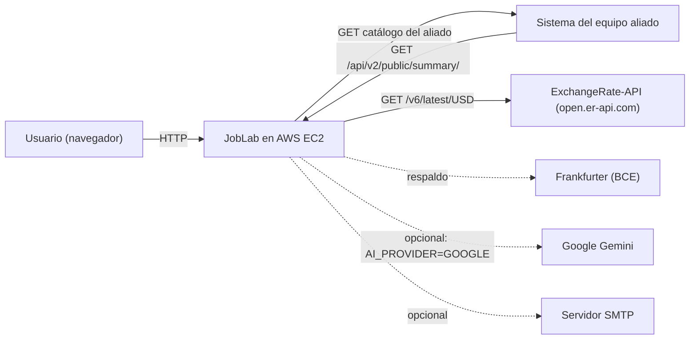
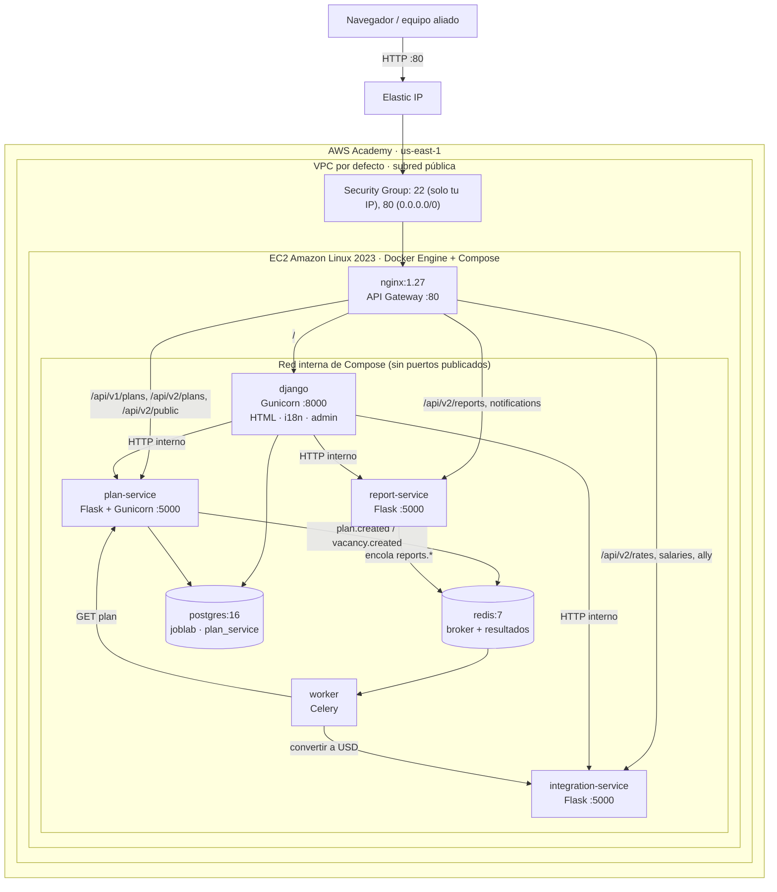
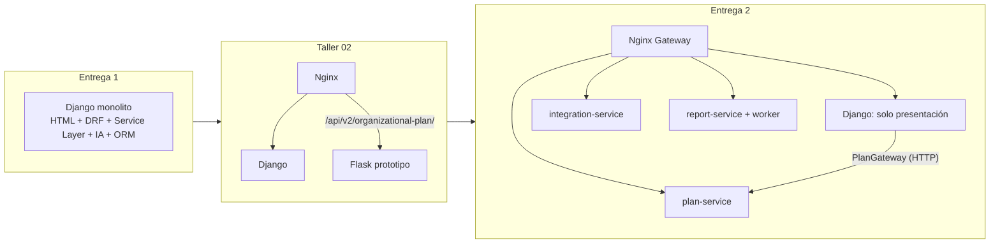
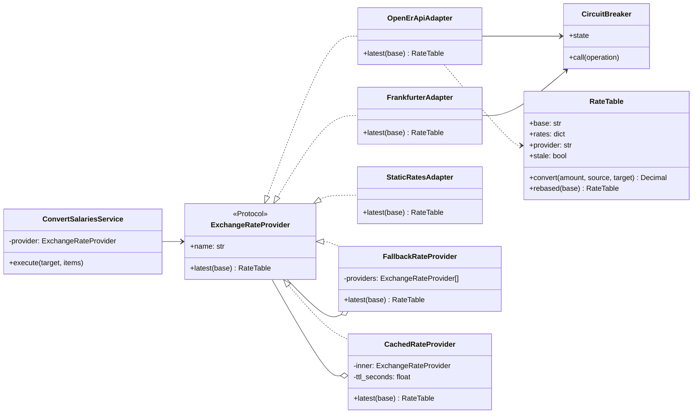
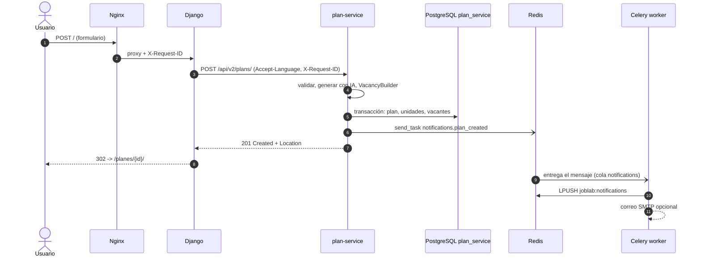
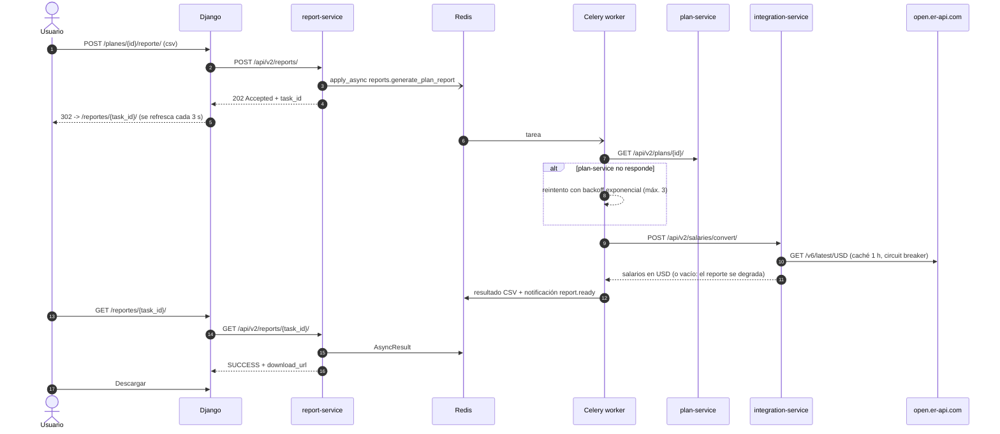

# Wiki técnica: Entrega 2

## JobLab: migración a microservicios, integración y resiliencia

Este documento es la fuente versionada de la Wiki de la Entrega 2. Describe la
arquitectura que existe en el repositorio: el monolito Django de la Entrega 1 se
estranguló hacia tres microservicios Flask, orquestados con Docker Compose detrás
de un API Gateway Nginx, con comunicación asíncrona mediante Redis y Celery, y
preparados para ejecutarse en una instancia EC2 de AWS Academy.

## 1. Matriz de cumplimiento

| Criterio (peso) | Requerimiento | Evidencia en el repositorio |
| --- | --- | --- |
| Correcciones E1 (10 %) | Ajustes indicados en la sustentación previa. | Sección 2. |
| Arquitectura (10 %) | Diagramas con AWS, Nginx, Flask y broker. | Secciones 3, 4, 7 y 8 de este documento. |
| Servicios (30 %) | Exponer API JSON, consumir el servicio del aliado y una API de terceros vía Adapter. | `GET /api/v2/public/summary/` (plan-service); `GET /api/v2/ally/` (integration-service, `HttpAllyCatalogAdapter`); `OpenErApiAdapter` y `FrankfurterAdapter` detrás del puerto `ExchangeRateProvider`. Sección 6. |
| Infraestructura (30 %) | Todo en Docker Compose, despliegue en EC2, ruteo por Nginx. | `docker-compose.yml` (8 contenedores), `nginx.conf`, `deploy/aws/*.sh`, job `compose-smoke` de GitHub Actions. Secciones 4 y 9. |
| Resiliencia y UX (20 %) | i18n con gettext, usabilidad, tareas asíncronas. | Celery + Redis (`services/report_service`), circuit breaker, reintentos, degradación controlada, catálogos `es/en`, [auditoría de UX](AUDITORIA_UX_I18N.md). Secciones 7, 8 y 10. |
| Bono (exención del Parcial 02) | Migrar más del 70 % de servicios y lógica a microservicios funcionales. | 6 de 7 servicios de aplicación de la Entrega 1 (85,7 %) y el 100 % de las capacidades de negocio del flujo activo. Sección 5. |

## 2. Correcciones de la Entrega 1

En la sustentación de la Entrega 1 el docente no dejó correcciones pendientes.
Además se hicieron estos ajustes preventivos:

- El contrato `/api/v1/plans/` se conserva intacto y ahora lo atiende `plan-service`.
  Las respuestas incluyen `X-API-Version: v1` y `Link: </api/v2/plans/>; rel="successor-version"`.
- Los textos de interfaz, validaciones y errores pasaron a `gettext`.
- El Service Layer, el Builder y la Factory de la Entrega 1 se migraron sin mover
  reglas a vistas ni serializers. La capa HTTP de cada microservicio sigue siendo delgada.

## 3. Vista de contexto



## 4. Despliegue en AWS Academy



| Contenedor | Imagen / build | Responsabilidad | Puerto publicado |
| --- | --- | --- | --- |
| `nginx` | `nginx:1.27-alpine` | API Gateway: ruteo, límites por IP, correlación, errores JSON, estáticos. | 80 |
| `django` | `./Dockerfile` | Presentación HTML (BFF), i18n, admin; ruta de reversión del estrangulador. | — |
| `plan-service` | `services/plan_service` | Planes, unidades, vacantes, IA, Builder, eventos; API v1 y v2. | — |
| `integration-service` | `services/integration_service` | API de terceros (tasas de cambio) y servicio del aliado mediante Adapters. | — |
| `report-service` | `services/report_service` | API de reportes asíncronos (202 Accepted) y notificaciones. | — |
| `worker` | `services/report_service` | Worker Celery: reportes CSV/JSON y consumo de eventos. | — |
| `postgres` | `postgres:16-alpine` | Una base por servicio: `joblab` (Django) y `plan_service`. | — |
| `redis` | `redis:7-alpine` | Broker de Celery, backend de resultados y registro de notificaciones. | — |

## 5. Patrón Estrangulador y porcentaje migrado



El estrangulamiento se hizo en dos frentes:

1. **Ruteo en el gateway:** Nginx envía `/api/v1/plans/...` a `plan-service`, que
   implementa el mismo contrato que tenía DRF (mismos códigos 200/201/400/404/409/503
   y el mismo sobre de error). Los clientes existentes no notan el cambio.
2. **Puerto en la interfaz:** las vistas HTML dependen del puerto `PlanGateway`.
   Con `PLAN_SERVICE_URL` configurado se usa `HttpPlanGateway`; si la variable se
   deja vacía se usa `LocalPlanGateway` con el Service Layer heredado. Así la
   migración se puede revertir sin tocar vistas ni plantillas.

### Inventario de servicios de aplicación de la Entrega 1

| Servicio de la Entrega 1 (`organization/services.py`) | Dónde se ejecuta ahora | Estado |
| --- | --- | --- |
| `GenerateOrganizationService` (IA + Factory + persistencia transaccional) | `plan-service` · `GenerateOrganizationService` | Migrado |
| `ListOrganizationalPlansService` | `plan-service` · `ListPlansService` | Migrado |
| `GetOrganizationalPlanService` | `plan-service` · `GetPlanService` | Migrado |
| `CreateVacancyService` (Builder, 404/409) | `plan-service` · `CreateVacancyService` | Migrado |
| `GetVacancyService` | `plan-service` · `GetVacancyService` | Migrado |
| `CalculatePlanMetricsService` | `plan-service` · `CalculatePlanMetricsService` | Migrado |
| `GetPlanDashboardService` (armar el árbol para la plantilla) | Django · `presenters.build_plan_page` | Permanece en Django como presentación |

**Resultado:** 6 de 7 servicios migrados (85,7 %). El que permanece solo da forma
al árbol para la plantilla y no contiene reglas de negocio.

### Capacidades de negocio del ecosistema

| Capacidad | Servicio |
| --- | --- |
| Validación de la descripción, defensa ante *prompt injection* | plan-service |
| Generación con IA (Mock / Gemini) mediante `AIProviderFactory` | plan-service |
| Jerarquía organizacional y construcción de vacantes con `VacancyBuilder` | plan-service |
| Métricas del plan | plan-service |
| Resumen público para el aliado | plan-service |
| Tasas de cambio y conversión de salarios | integration-service |
| Consumo del servicio del aliado | integration-service |
| Reportes CSV/JSON | report-service (worker) |
| Notificaciones por eventos | report-service (worker) |

En el flujo activo, las 9 capacidades se ejecutan en microservicios (100 %).
Django conserva la interfaz HTML, la internacionalización, el panel de
administración y la ruta de reversión.

## 6. Integración y patrones estructurales

### 6.1 Servicio a proveer (para el equipo aliado)

`GET /api/v2/public/summary/?limit=10` devuelve, sin autenticación y con CORS
habilitado en el gateway:

```json
{
  "system": "JobLab",
  "service": "plan-service",
  "version": "2.0.0",
  "description": "Resumen público de planes organizacionales y vacantes generadas en JobLab.",
  "totals": {"plans": 3, "departments": 12, "vacancies": 15, "positions": 21},
  "top_skills": [{"name": "Python", "vacancies": 3}],
  "latest_vacancies": [
    {
      "plan_id": 3, "company_name": "Empresa Tecnologica en Formacion",
      "vacancy_id": 15, "name": "Desarrollador Full Stack", "department": "Tecnologia y Producto",
      "available_positions": 2, "salary_min": "4000000.00", "salary_max": "6000000.00",
      "currency": "COP", "salary_period": "MONTHLY",
      "required_knowledge": ["Python", "Django"], "status": "DRAFT"
    }
  ]
}
```

También queda disponible el contrato completo de `/api/v2/plans/`.

### 6.2 Servicio a consumir (del equipo aliado)

`integration-service` consume el endpoint configurado en `ALLY_SERVICE_URL`
mediante `HttpAllyCatalogAdapter`. Este adaptador traduce cualquier lista JSON al
modelo neutral `AllyCatalog(items: AllyItem[title, subtitle, description, url])`
con nombres de campos configurables (`ALLY_ITEMS_PATH`, `ALLY_FIELD_*`). La
página **Aliados** de Django muestra el resultado. `CachedAllyCatalog` devuelve
la última copia buena (marcada como desactualizada) si el aliado deja de responder.

### 6.3 API de terceros mediante Adapter e inversión de dependencias



| Patrón | Dónde | Propósito |
| --- | --- | --- |
| **Adapter** | `OpenErApiAdapter`, `FrankfurterAdapter`, `HttpAllyCatalogAdapter`, `HttpPlanGateway`, `HttpReportGateway` | Traducen el esquema de cada API externa (`base_code`, `rates`, `time_last_update_unix` o el JSON del aliado) a tipos del dominio. |
| **Decorator** | `CachedRateProvider`, `CachedAllyCatalog` | Agregan caché TTL y respaldo con datos desactualizados sin cambiar el puerto. |
| **Composite / cadena de respaldo** | `FallbackRateProvider` | Recorre varios proveedores y usa el primero que tenga COP, USD, EUR y MXN. |
| **Proxy de protección** | `CircuitBreaker` + `ServiceClient` | Corta las llamadas a un servicio caído y deja pasar una prueba (*half-open*) después del tiempo de espera. |
| **Null Object** | `UnavailableGateway`, `NullEventPublisher` | Permiten funcionar sin un servicio configurado sin llenar las vistas de condicionales. |
| **Facade** | Nginx API Gateway | Un único punto de entrada para todo el ecosistema. |
| **Builder / Factory (E1)** | `VacancyBuilder`, `AIProviderFactory`, `ReportRendererFactory` | Se conservan dentro de los microservicios. |

`ConvertSalariesService` depende solo del puerto. Cambiar de proveedor de tasas es
cuestión de configuración (`EXCHANGE_PROVIDERS=frankfurter,static`) y no requiere
modificar el servicio.

## 7. Comunicación asíncrona

### 7.1 Eventos de dominio



### 7.2 Reporte en segundo plano (202 Accepted)



| Cola | Tareas | Política |
| --- | --- | --- |
| `reports` | `reports.generate_plan_report` | `autoretry_for=UpstreamUnavailable`, `retry_backoff`, `max_retries=3`; `PlanNotFound` falla sin reintento. |
| `notifications` | `notifications.plan_created`, `notifications.vacancy_created` | Se registran en Redis (máximo 100) y se envían por correo si hay SMTP. |

`task_acks_late`, `task_reject_on_worker_lost` y `worker_prefetch_multiplier=1`
evitan perder tareas si el worker se reinicia a mitad de una ejecución.

## 8. Resiliencia

| Mecanismo | Implementación |
| --- | --- |
| Timeouts | Todas las llamadas salientes (`SERVICE_TIMEOUT_SECONDS`, `HTTP_TIMEOUT_SECONDS`); Nginx `proxy_connect_timeout 3s`. |
| Reintentos | `urllib3.Retry` con backoff solo para GET; Celery con backoff exponencial y jitter; Nginx `proxy_next_upstream error timeout` (nunca reintenta POST). |
| Circuit breaker | `organization/gateways/resilience.py` (uno por servicio en Django) e `integration_service/resilience.py` (uno por proveedor externo). |
| Respaldo | Cadena de proveedores de tasas, tabla estática de referencia y última copia del aliado. |
| Degradación controlada | Sin conversión el plan se muestra igual; sin aliado o sin notificaciones se explica el motivo; sin plan-service se muestra una página 503 con *Reintentar*. |
| Salud | `/health` en cada servicio, `/health/` en Django, `/gateway/health` en Nginx, healthchecks de Compose y la página **Estado**. |
| Correlación | `X-Request-ID` se genera en Nginx y se propaga por Django y los microservicios. |
| Protección del borde | `limit_req` por IP (20 r/s general, 1 r/s para POST de planes), `client_max_body_size 1m`, cabeceras de seguridad y `server_tokens off`. |

## 9. Ejecución y verificación

- **Ejecución local completa:** `docker compose up -d --build` y abrir <http://localhost/>.
  El README tiene el paso a paso para usuarios sin experiencia.
- **Prueba de humo:** `bash deploy/aws/smoke-test.sh http://<ip>` recorre el gateway,
  los tres microservicios y la creación de un plan.
- **Despliegue en EC2:** `deploy/aws/ec2-user-data.sh` (instalación desatendida) y
  `deploy/aws/deploy.sh` (actualizaciones).
- **Integración continua:** el workflow `Tests` ejecuta las pruebas de Django y de
  cada microservicio, verifica los catálogos de traducción y, en el job
  `compose-smoke`, construye las 8 piezas con Docker Compose, espera los
  healthchecks y genera un plan y un reporte asíncrono a través de Nginx.

| Suite | Pruebas |
| --- | ---: |
| Django (`manage.py test`) | 78 |
| plan-service | 27 |
| integration-service | 18 |
| report-service | 9 |

## 10. Internacionalización y usabilidad

El detalle está en [AUDITORIA_UX_I18N.md](AUDITORIA_UX_I18N.md). En resumen: todo
texto de interfaz pasa por `gettext` (Django) o Flask-Babel (microservicios), hay
catálogos en español e inglés y un selector de idioma, y Django propaga
`Accept-Language` a los microservicios. `scripts/i18n.py check` impide integrar
cadenas sin traducir.

## 11. Estructura del repositorio

```text
JobLab/
|-- joblab/                        configuración Django, /health/, middleware de correlación
|-- organization/
|   |-- gateways/                  puertos y adaptadores hacia los microservicios (estrangulador)
|   |-- presenters.py              modelo de presentación del árbol (sin reglas de negocio)
|   |-- views.py, templates/       interfaz HTML internacionalizada
|   |-- services.py, domain/, api/ Service Layer heredado (ruta de reversión y API v1 local)
|-- services/
|   |-- plan_service/              Flask + SQLAlchemy: planes, IA, Builder, eventos
|   |-- integration_service/       Flask: Adapters de tasas de cambio y del aliado
|   `-- report_service/            Flask + Celery: reportes y notificaciones
|-- locale/                        catálogo gettext de Django (en)
|-- deploy/                        entrypoint, init de PostgreSQL y scripts de AWS EC2
|-- scripts/i18n.py                extracción, compilación y verificación de catálogos
|-- nginx.conf                     API Gateway
`-- docker-compose.yml             orquestación del ecosistema
```
