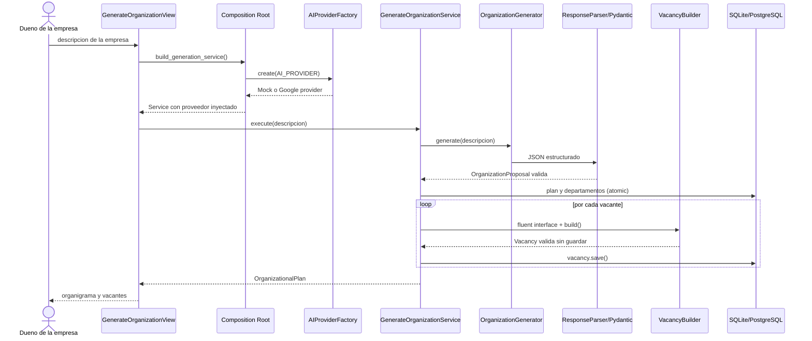
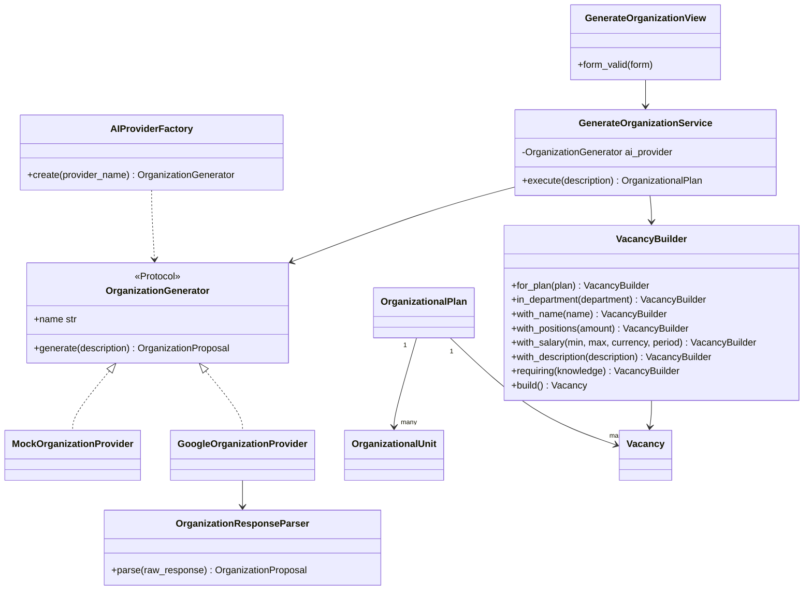

# Implementacion del Patron Creacional

> Documento complementario. La matriz completa de la Entrega 1, el baseline de
> dominio, la API REST y la estrategia de escalabilidad se encuentran en la
> [Wiki tecnica versionada](ENTREGABLE_1.md).

## 1. Funcionalidad seleccionada

Se implemento el caso de uso critico **generar una estructura organizacional y
sus vacantes a partir de la descripcion y capacidades de una empresa**. Es una
funcionalidad apropiada para el taller porque combina entrada no confiable,
reglas de negocio, construccion de objetos complejos, integracion externa y
persistencia transaccional.

El flujo entrega:

- resumen interpretado de la empresa;
- supuestos realizados durante la generacion;
- departamentos con relaciones padre-hijo;
- vacantes con puestos disponibles, salario estimado, descripcion,
  conocimientos y relacion de reporte.

## 2. Problema que evita la arquitectura

Una implementacion monolitica pondria dentro de la vista la seleccion del
proveedor, la llamada a Gemini, el parseo, las validaciones, la creacion de la
jerarquia y los `save()`. Esa vista seria dificil de probar, acoplada a Google y
capaz de dejar datos parciales si una operacion falla.

La solucion separa las responsabilidades y deja `form_valid()` por debajo de 15
lineas: recibe datos validados, obtiene el Service desde el punto de composicion,
ejecuta un metodo y produce la redireccion o un error de formulario.

## 3. Flujo de interaccion



## 4. Diagrama de clases



## 5. Service Layer e inyeccion de dependencias

`GenerateOrganizationService` representa el caso de uso y no conoce HTTP,
formularios, plantillas, variables de entorno ni detalles del SDK de Google.
Recibe un `OrganizationGenerator` por constructor:

```python
class GenerateOrganizationService:
    def __init__(self, ai_provider: OrganizationGenerator) -> None:
        self.ai_provider = ai_provider
```

`bootstrap.py` es el punto de composicion. Alli la Factory construye la
implementacion y esta se inyecta en el Service. Esto conserva inversion de
dependencias: la capa de aplicacion depende de un contrato pequeno, no de Google.

El Service tambien:

1. normaliza la descripcion;
2. registra y actualiza el estado de la solicitud;
3. solicita y valida la propuesta;
4. crea el plan y resuelve la jerarquia;
5. construye las vacantes;
6. guarda todo en `transaction.atomic()`;
7. marca los errores sin conservar datos parciales.

## 6. Builder con Fluent Interface

`VacancyBuilder`, ubicado en `domain/`, permite una construccion legible:

```python
vacancy = (
    VacancyBuilder()
    .for_plan(plan)
    .in_department(department)
    .with_name(data.name)
    .with_positions(data.available_positions)
    .with_salary(
        data.salary_min,
        data.salary_max,
        data.currency,
        data.salary_period,
    )
    .with_description(data.description)
    .requiring(data.required_knowledge)
    .reporting_to(data.reports_to)
    .build()
)
```

Cada metodo retorna `self`. `build()` verifica campos obligatorios, pertenencia
del departamento, cantidad positiva, rango salarial, descripcion y conocimientos;
luego ejecuta `full_clean()` y retorna un modelo **sin guardar**. De este modo, el
Service conserva el control de la transaccion.

## 7. Factory y cambio por ambiente

`AIProviderFactory`, ubicada en `infra/ai/`, admite solo:

- `AI_PROVIDER=MOCK`: respuesta determinista, sin red, costo o credenciales;
- `AI_PROVIDER=GOOGLE`: cliente Gemini real con salida JSON estructurada.

Un valor desconocido falla inmediatamente con `ImproperlyConfigured`. El modo
`GOOGLE` tambien exige `GEMINI_API_KEY`, que nunca se versiona. La demostracion
del cambio esta automatizada en `test_factory.py`.

## 8. Validacion por capas

La salida estructurada reduce ambiguedad, pero no reemplaza la validacion
semantica. El sistema aplica:

1. formulario y validador de descripcion (longitud, normalizacion e intentos
   comunes de sustituir instrucciones);
2. JSON puro sin bloques Markdown;
3. modelos Pydantic con tipos, limites, enumeraciones y campos extra prohibidos;
4. codigos unicos, una raiz, padres existentes y ausencia de ciclos;
5. departamentos validos y vacantes no duplicadas;
6. reglas del Builder y `full_clean()` de Django;
7. restricciones `UNIQUE` y `CHECK` en la base de datos.

## 9. SOLID demostrado

- **SRP:** View maneja HTTP; Service orquesta; Builder construye; Factory elige;
  Provider integra; Parser valida.
- **OCP:** puede agregarse otro Provider sin cambiar el algoritmo del Service.
- **LSP:** Mock y Google satisfacen el mismo `Protocol`.
- **ISP:** `OrganizationGenerator` solo exige `name` y `generate()`.
- **DIP:** el Service recibe el contrato desde el punto de composicion.

## 10. Pruebas y evidencia

La suite cubre Builder, Factory, parser, Service y CBV:

```text
python manage.py makemigrations --check --dry-run
python manage.py check
python manage.py test
```

Casos principales:

- construccion valida sin guardar;
- campos faltantes, rango salarial invalido y departamento incorrecto;
- seleccion `MOCK/GOOGLE` y valor desconocido;
- JSON valido, Markdown, campos extra y referencias inexistentes;
- persistencia completa y rollback ante fallos del proveedor o dentro de la transacción;
- vista accesible, delegacion al Service y pagina de resultados.

GitHub Actions ejecuta las mismas comprobaciones en cada Pull Request. El
resultado definitivo debe corresponder al mismo commit publicado en `main` o
`develop`. La verificación local del entregable completó 55 pruebas.

## 11. Decisiones y limites

- SQLite simplifica la demostracion local; el ORM permite migrar a PostgreSQL.
- El modo Mock infiere solo una estructura basica: no pretende imitar la calidad
  de Gemini.
- El resultado siempre se guarda como borrador y expone sus supuestos.
- Los salarios se almacenan con moneda y periodicidad y se muestran como
  estimaciones, nunca como informacion oficial del mercado.
- No se implemento publicacion automatica de vacantes porque exigiria revision,
  autorizacion y reglas legales fuera del alcance del taller.
