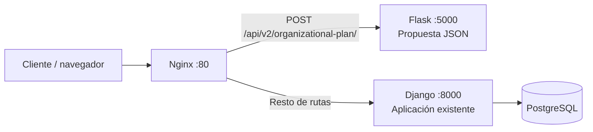

# Implementación del patrón Estrangulador (Strangler)

## Propósito y alcance

Este documento describe la implementación del patrón Strangler en JobLab para
el Taller 02. Es una página independiente de la documentación de la Entrega 1:
no reemplaza ni modifica el contenido de `ENTREGABLE_1.md`.

JobLab conserva su aplicación monolítica Django y extrae de forma gradual una
capacidad de negocio a un microservicio Flask. Nginx actúa como punto de entrada
y dirige las solicitudes según la ruta. La implementación demuestra la
coexistencia de ambas aplicaciones; el endpoint Flask es una primera versión
aislada y no equivale todavía a la generación con IA ni a la persistencia del
flujo Django.

## Matriz de decisión

Se compararon tres capacidades de JobLab para seleccionar qué extraer primero.
La escala cualitativa va de 1 (bajo) a 5 (alto). En la columna de riesgo, 5
significa que la capacidad es relativamente fácil y segura de aislar. Los
pesos y puntajes son una evaluación arquitectónica para orientar la decisión,
no métricas recogidas en producción.

| Módulo candidato | Centralidad para el negocio (35 %) | Aislamiento del monolito (30 %) | Beneficio de evolución independiente (20 %) | Menor riesgo de extracción (15 %) | Total / 5 |
| --- | ---: | ---: | ---: | ---: | ---: |
| Generación de propuesta organizacional | 5 | 4 | 5 | 3 | **4,35** |
| Selección e integración de proveedores IA | 4 | 2 | 3 | 2 | 2,90 |
| Historial y administración de planes/vacantes | 3 | 2 | 2 | 2 | 2,35 |

### Candidato seleccionado: generación de la propuesta organizacional

Esta capacidad produce el resultado principal que JobLab entrega al usuario y
puede exponerse mediante una interfaz HTTP con entrada y salida JSON. Separarla
permite evolucionar o desplegar esa capacidad independientemente sin migrar de
inmediato la interfaz web ni las pantallas administrativas.

La selección e integración de proveedores IA es menos adecuada como primera
extracción: actualmente se apoya en el puerto `OrganizationGenerator`, la
factoría, los esquemas y la orquestación del Service Layer. El historial y la
administración dependen directamente de los modelos y transacciones Django. Su
separación inicial impondría más coordinación entre servicios y acceso a datos.

## Arquitectura y rutas



La regla de Nginx para `/api/v2/organizational-plan/` envía la solicitud a
Flask. Las demás rutas llegan a Django. PostgreSQL respalda Django en la
configuración de Compose; Flask no comparte ni persiste datos en esa base.

## Microservicio Flask

El servicio vive en `microservice/` y expone:

| Método | Ruta | Función |
| --- | --- | --- |
| `GET` | `/` | Identifica el servicio y enumera sus rutas. |
| `GET` | `/health` | Devuelve el estado del microservicio. |
| `POST` | `/api/v2/organizational-plan/` | Valida la descripción y genera una propuesta JSON. |

La solicitud `POST` debe incluir `company_description` como texto de al menos
80 caracteres:

```json
{
  "company_description": "Somos una empresa de software que desarrolla productos digitales para PYMES y necesita una estructura clara para ingeniería, operaciones y ventas."
}
```

Una respuesta exitosa incluye `source: "flask"`, `pattern: "strangler"` y una
`proposal` con nombre de empresa, supuestos, departamentos y vacantes. Las
entradas inválidas responden con HTTP `400` y un objeto `error` con `code` y
`detail`.

En esta etapa, la lógica de Flask aplica reglas deterministas según palabras de
la descripción. No invoca el proveedor de IA de Django, no crea un
`OrganizationalPlan` y no escribe unidades ni vacantes en PostgreSQL. Es una
extracción funcional inicial del contrato y del ruteo, no una sustitución con
paridad funcional completa.

## Infraestructura y enrutamiento

`docker-compose.yml` levanta cuatro servicios:

- `django`: monolito existente, puerto interno `8000`.
- `flask`: microservicio extraído, puerto interno `5000`.
- `db`: PostgreSQL; su healthcheck espera a que acepte conexiones antes de
  iniciar las migraciones de Django.
- `nginx`: entrada externa en el puerto `80` y proxy inverso por ruta.

Las rutas de entrada locales son:

| URL | Destino |
| --- | --- |
| `http://localhost/` | Django a través de Nginx. |
| `http://localhost/api/v2/organizational-plan/` | Flask a través de Nginx; requiere `POST` JSON. |
| `http://localhost:5000/health` | Health check directo de Flask. |
| `http://localhost:8000/` | Django directamente, sin Nginx. |

## Ejecución y verificación

Desde la raíz del proyecto, iniciar la arquitectura:

```powershell
docker compose up --build -d
docker compose ps
```

Confirma que `django`, `flask`, `nginx` y `db` estén ejecutándose y que `db`
aparezca como `healthy`. Comprueba el health check directo de Flask:

```powershell
Invoke-RestMethod -Method Get -Uri "http://localhost:5000/health"
```

Prueba el endpoint pasando por Nginx:

```powershell
$payload = @{
    company_description = "Somos una empresa de software que desarrolla productos digitales para PYMES y necesita una estructura clara para ingeniería, operaciones y ventas."
}
$body = ConvertTo-Json -InputObject $payload -Compress

$plan = Invoke-RestMethod `
    -Method Post `
    -Uri "http://localhost/api/v2/organizational-plan/" `
    -ContentType "application/json; charset=utf-8" `
    -Body ([System.Text.Encoding]::UTF8.GetBytes($body))

$plan | ConvertTo-Json -Depth 10
$plan.source
$plan.proposal.departments.Count
$plan.proposal.vacancies.Count
```

La respuesta debe mostrar `source` igual a `flask` y una propuesta no vacía. En
la prueba actual con una descripción de empresa de software se esperan cuatro
departamentos y dos vacantes. Para comprobar que el proxy conserva el resto del
monolito:

```powershell
(Invoke-WebRequest -Uri "http://localhost/" -UseBasicParsing).StatusCode
```

Debe devolver `200`. `http://localhost/health` no es el health check de Flask:
Nginx enruta las rutas distintas a `/api/v2/organizational-plan/` hacia Django.

Ejecuta las pruebas unitarias del microservicio desde la raíz del repositorio:

```powershell
.\.venv\Scripts\python.exe -m unittest discover -s microservice -p "test_*.py" -v
```

Estas pruebas comprueban la respuesta JSON satisfactoria y los errores de
descripción ausente o demasiado corta. Para detener los contenedores:

```powershell
docker compose down
```

## Impacto esperado y evolución

La ruta dedicada permite desplegar y cambiar la capacidad extraída sin
interrumpir las demás funciones de Django. El enrutamiento por Nginx conserva una
entrada común para cliente y facilita reemplazar gradualmente rutas del
monolito. La separación también introduce responsabilidades operativas nuevas:
supervisión del servicio Flask, disponibilidad de la red entre contenedores,
versionado del contrato y manejo explícito de fallos.

Próximos pasos para completar una migración funcional de extremo a extremo:

1. Acordar y versionar el contrato JSON de entrada y salida con consumidores.
2. Llevar al servicio nuevo la generación de la propuesta que hoy realiza el
   dominio existente, manteniendo sus validaciones.
3. Definir propiedad y persistencia de los planes, así como la estrategia de
   transición de datos.
4. Añadir pruebas de contrato y de integración a través de Nginx.
5. Medir errores, latencia y uso antes de desviar más tráfico; definir fallback
   y plan de reversión.

## Publicación como página nueva en GitHub Wiki

La fuente versionada de esta página es
`docs/IMPLEMENTACION_PATRON_ESTRANGULADOR.md`. Para publicarla sin mezclarla con
la página de Entrega 1:

1. Abre la pestaña **Wiki** del repositorio en GitHub.
2. Selecciona **Create the first page** o **New page**.
3. Usa el título **Implementacion Patron Estrangulador**.
4. Copia el contenido de este archivo al editor de la Wiki y guarda la página.
5. Revisa el diagrama Mermaid y las tablas en el renderizado de GitHub.

La página Wiki es un repositorio separado de las ramas de código: subir este
archivo a una rama no lo publica automáticamente en la Wiki. Si se quiere
mantener sincronización automática, debe copiarse el contenido o configurarse
un flujo aparte para publicar en el repositorio `.wiki`.
